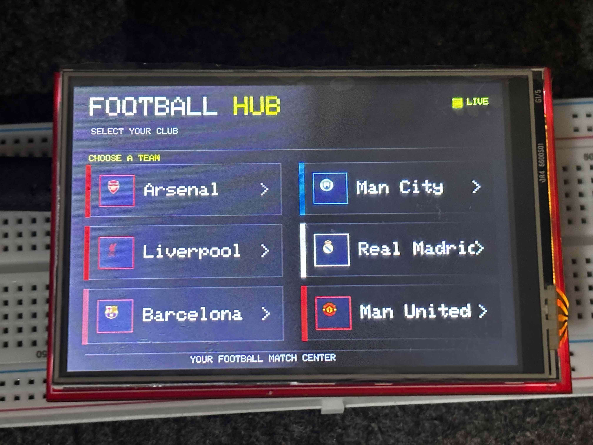

  

# Football Hub

**Version:** 0.0.1

Football Hub is a compact football match display built with an Arduino UNO WiFi R3, an ILI9486 TFT touchscreen, and the ESP8266 module.

The display allows users to select a football club and view its latest completed match and next scheduled match.

## Features

- Touchscreen club selection
- Latest completed match
- Next scheduled match
- Live data retrieval through football-data.org
- Separate firmware for the ATmega328P and ESP8266
- 480 × 320 landscape display

## Supported Clubs

| Club | Team ID |
|---|---:|
| Arsenal | 57 |
| Manchester City | 65 |
| Liverpool | 64 |
| Real Madrid | 86 |
| Barcelona | 81 |
| Manchester United | 66 |

## Hardware

- Arduino UNO WiFi R3
- 3.5-inch ILI9486 TFT touchscreen
- Wi-Fi connection
- football-data.org API token

## Libraries

Install the following libraries:

- LCDWIKI_KBV
- LCDWIKI_GUI
- TouchScreen
- ArduinoJson

Install the ESP8266 board package through Arduino IDE Boards Manager.

## Configuration

1. Open the ESP8266 firmware folder.
2. Copy `secrets.example.h`.
3. Rename the copy to `secrets.h`.
4. Enter your Wi-Fi credentials and football-data.org API token.
5. Keep `secrets.h` private.

## Uploading

### UNO

1. Open `Football_Hub_UNO.ino`.
2. Select Arduino Uno.
3. Install the LCDWIKI and TouchScreen libraries.
4. Upload the sketch to the ATmega328P.

### ESP8266

1. Open `Football_Hub_ESP8266.ino`.
2. Make sure `secrets.h` exists in the same folder.
3. Select the ESP8266 board profile that matches your module.
4. Install ArduinoJson.
5. Upload the sketch to the ESP8266.

The two firmware sketches are uploaded separately.

## Serial Protocol

The UNO sends:

`TEAM|57`

The ESP8266 responds with:

- `LAST|home|away|date|homeScore|awayScore`
- `NEXT|home|away|date`
- `ERROR|message`
- `END`

Serial communication uses 9600 baud.

## Club Logos

The UNO sketch expects six 16 × 16 RGB565 logo arrays in `club_logos.h`. Replace the placeholder arrays with the actual logo pixel data before using the logo display.

The color `0x18E3` is treated as transparent.

## Notes

- Match dates are displayed in UTC.
- API availability depends on your football-data.org account.
- The current HTTPS client configuration skips certificate validation.
- Hardware behavior should be verified on the target board after installation.

## Version

Current release: **0.0.1**
